# Cuttr AI Features — Technical Documentation

Comprehensive technical documentation for the three core AI-powered features: **AI Clipping**, **Face Swap**, and **AI UGC Video Generation**.

---

## Table of Contents

- [1. AI Clipping Flow](#1-ai-clipping-flow)
  - [1.1 Overview](#11-overview)
  - [1.2 Architecture Diagram](#12-architecture-diagram)
  - [1.3 Upload & Ingestion](#13-upload--ingestion)
  - [1.4 Transcription (Deepgram)](#14-transcription-deepgram)
  - [1.5 AI Clip Suggestion Engine](#15-ai-clip-suggestion-engine)
  - [1.6 Video Processing Pipeline](#16-video-processing-pipeline)
  - [1.7 Captions & Overlays](#17-captions--overlays)
  - [1.8 Batch Clipping (Multi-Source)](#18-batch-clipping-multi-source)
  - [1.9 Post-Processing Edits](#19-post-processing-edits)
  - [1.10 Database Schema](#110-database-schema)
  - [1.11 Key Files](#111-key-files)
- [2. Face Swap](#2-face-swap)
  - [2.1 Overview](#21-overview)
  - [2.2 Architecture Diagram](#22-architecture-diagram)
  - [2.3 Face Detection (Lambda)](#23-face-detection-lambda)
  - [2.4 Swap Modes](#24-swap-modes)
  - [2.5 Worker Processing Pipeline](#25-worker-processing-pipeline)
  - [2.6 Splice Mode](#26-splice-mode)
  - [2.7 Voice Conversion](#27-voice-conversion)
  - [2.8 API (External Integration)](#28-api-external-integration)
  - [2.9 Database Schema](#29-database-schema)
  - [2.10 Key Files](#210-key-files)
- [3. AI UGC Video Generation](#3-ai-ugc-video-generation)
  - [3.1 Overview](#31-overview)
  - [3.2 Architecture Diagram](#32-architecture-diagram)
  - [3.3 Character Generation](#33-character-generation)
  - [3.4 Script Generation (AI Agents)](#34-script-generation-ai-agents)
  - [3.5 Script Structures & Scene Types](#35-script-structures--scene-types)
  - [3.6 Scene Image Generation](#36-scene-image-generation)
  - [3.7 Video Assembly Pipeline](#37-video-assembly-pipeline)
  - [3.8 Voice Cloning](#38-voice-cloning)
  - [3.9 Ad Clone Flow](#39-ad-clone-flow)
  - [3.10 Database Schema](#310-database-schema)
  - [3.11 Key Files](#311-key-files)
- [4. Shared Infrastructure](#4-shared-infrastructure)
  - [4.1 SQS Job Queue](#41-sqs-job-queue)
  - [4.2 Worker Architecture](#42-worker-architecture)
  - [4.3 Real-Time Updates (Socket.io)](#43-real-time-updates-socketio)
  - [4.4 External AI Services Summary](#44-external-ai-services-summary)

---

## 1. AI Clipping Flow

### 1.1 Overview

The AI Clipping system automatically analyzes long-form video content and extracts short, compelling clips optimized for social media. It combines speech-to-text transcription, AI-driven segment analysis, and automated video processing with captions, overlays, and aspect ratio conversion.

**Key capabilities:**
- Single or multi-source video clipping (up to 5 source videos)
- AI-powered hook + main segment selection with virality scoring
- Automatic 9:16 vertical conversion with multiple modes (blur, gaming, speaker-zoom, active-speaker, center-crop)
- Multi-language captions with 20+ Unicode script support
- Auto-generated viral headings
- Background music mixing
- Watermarked preview + blank video for non-destructive editing

### 1.2 Architecture Diagram

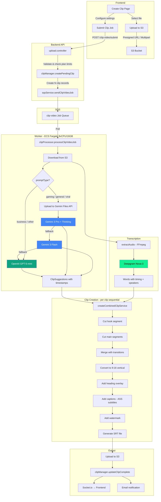

### 1.3 Upload & Ingestion

Users upload videos via two mechanisms:

| Method | Max Size | Use Case |
|--------|----------|----------|
| Presigned URL | 50 MB | Small files, single PUT |
| Multipart Upload | 2 GB | Large files, 10 MB chunks |

**URL download** is also supported for YouTube, Instagram, Twitch, and other platforms:
- `POST /clip-video/url/download` — async download with streaming progress via Socket.io
- `POST /clip-video/url/download-sync` — synchronous download (for API)

**Validation:**
- Accepted formats: MP4, MOV, AVI, MKV, WebM
- Max duration: 30 minutes per video
- Free plan: limited generations per month (checked at submit time)
- Clip length: 10–120 seconds
- Hook length: 2–15 seconds
- Number of clips: 1–25 per submission

### 1.4 Transcription (Deepgram)

**Service:** `backend/src/services/clips/transcription.service.ts`

Audio is extracted via FFmpeg, then sent to **Deepgram Nova-3**:

```
Video → FFmpeg extractAudio → Deepgram Nova-3 → SyncPrerecordedResponse
```

**Deepgram configuration:**

| Parameter | Value | Purpose |
|-----------|-------|---------|
| `model` | `nova-3` | Latest model, highest accuracy |
| `smart_format` | `true` | Clean formatting |
| `punctuate` | `true` | Automatic punctuation |
| `diarize` | `true` | Speaker identification |
| `paragraphs` | `true` | Paragraph grouping |
| `detect_language` | `true` | Auto language detection |

**Output structure:**
- `transcript` — full text string
- `words[]` — array of `{ start, end, punctuated_word, speaker, confidence }`
- `paragraphs` — structured paragraph groupings

For **batch clipping**, `transcribeMultipleVideosService()` transcribes all videos in parallel.

### 1.5 AI Clip Suggestion Engine

**Service:** `backend/src/services/aiSuggestions.service.ts`

The AI analyzes transcription data (and optionally the video itself) to identify the most compelling segments.

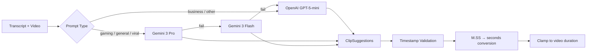

**Model selection logic:**
- **Gaming / General / Viral**: Video is uploaded to Gemini Files API for visual analysis. Uses `gemini-3-pro-preview` with `thinkingLevel: HIGH`. Falls back to `gemini-3-flash-preview`, then to OpenAI.
- **Business / other transcript-only modes**: Uses `gpt-5-mini` with `effort: "medium"` reasoning and structured output via Zod schemas.

**ClipSuggestions schema:**

```typescript
{
  hook?: { start: number, end: number, text: string }   // Optional attention-grabbing opening
  main: [{ start: number, end: number, text: string }]  // Main content segments
  combined_script: string     // Full combined text
  finalMessage: string        // Why this clip is viral-worthy
  evalScore: number           // 0–100 viral potential score
  clipTitle: string           // Catchy title
  viralHeading: string        // 3–6 word overlay text with emojis
}
```

**Prompt templates** (`backend/src/config/prompts.ts`) include 50+ narrative structures:
- Climax → Explanation → Reinforce
- Problem → Pain → Solution
- Contrarian Take
- Myth → Reality
- Question → Breakdown → Answer

### 1.6 Video Processing Pipeline

**Processor:** `backend/src/worker/processors/clipProcessor.ts`

Each clip is processed sequentially through these stages:

| Step | Operation | Service |
|------|-----------|---------|
| 1 | Cut hook segment | `videoEditor.cutClip()` |
| 2 | Cut main segments | `videoEditor.cutClip()` |
| 3 | Merge segments | `videoEditor.mergeClips()` |
| 4 | Aspect ratio conversion | `aspectRatioConversion.convertToVertical()` |
| 5 | Heading overlay | `textOverlay.addTextOverlayAtPosition()` |
| 6 | Captions | `captions.addCaptionsOverlay()` |
| 7 | Watermark | `videoEditor.addPreviewWatermark()` |
| 8 | Generate SRT | In-memory SRT generation |

**Conversion modes** for vertical (9:16):

| Mode | Description |
|------|-------------|
| `standard` | Letterbox with blur background |
| `gaming` | Optimized for gameplay footage |
| `speaker-zoom` | Face-detect + zoom on speaker |
| `center-crop` | 1:1 center crop (Instagram) |
| `active-speaker` | Dynamic speaker-following zoom |

**Output artifacts per clip:**
- `clip_path` — final clip with all overlays
- `blank_video_path` — clip without captions (for non-destructive re-editing)
- `watermarked_clip_path` — watermarked preview version
- `srt_path` — SRT subtitle file

### 1.7 Captions & Overlays

**Service:** `backend/src/services/clips/captions.service.ts`

Captions are rendered as ASS (Advanced SubStation Alpha) subtitles:
- Words grouped in chunks of 4 (`WORDS_PER_GROUP`)
- Current word highlighted with accent color
- Mobile-optimized layout (MarginV 280 for safe zones)
- Resolution: 1080×1920 (9:16)

**Multi-language font support** — automatic detection via Unicode ranges:

| Script | Font |
|--------|------|
| Latin (default) | Montserrat, Luckiest Guy, Bebas Neue, etc. |
| Devanagari (Hindi) | Noto Sans Devanagari |
| Chinese | Noto Sans SC |
| Japanese | Noto Sans JP |
| Korean | Noto Sans KR |
| Arabic | Noto Sans Arabic |
| + 15 more scripts | Appropriate Noto Sans variant |

**Heading AI** (`headingAI.service.ts`): Uses GPT-5-mini to generate 3–6 word viral headings with capitalized keywords and 1–2 emojis.

### 1.8 Batch Clipping (Multi-Source)

**Processor:** `backend/src/worker/processors/batchClipProcessor.ts`

Supports 2–5 source videos that are analyzed together:

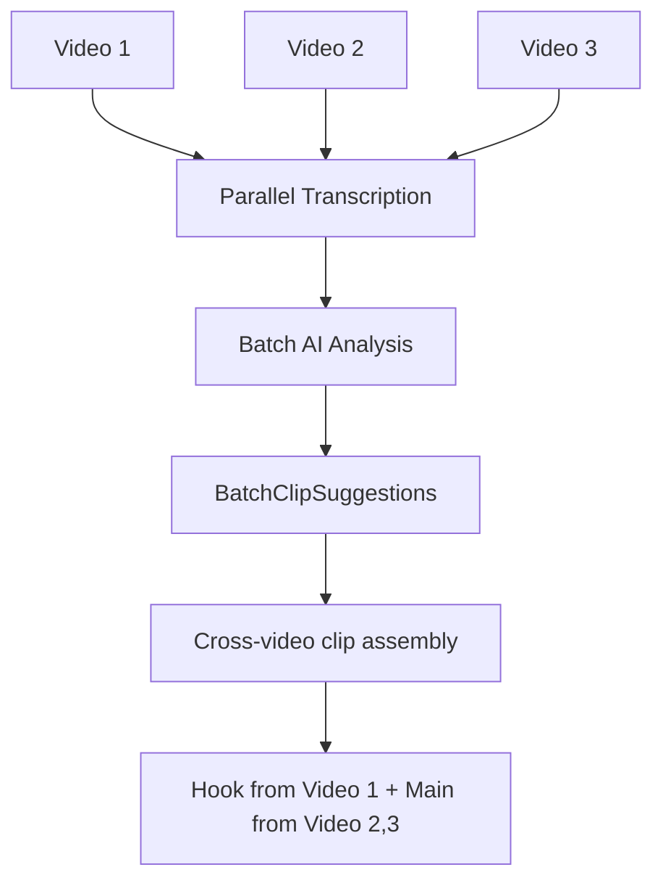

The AI can select the best hook from any video and compose main segments from multiple sources. Each segment carries a `sourceVideoIndex` to identify which source video it came from.

### 1.9 Post-Processing Edits

After clip generation, users can edit without re-running the full pipeline:

| Edit Type | Job Type | What Happens |
|-----------|----------|--------------|
| Caption edit | `update-captions` | Re-renders captions on blank video |
| Heading edit | `text-overlay` | Re-renders heading on blank video |
| Combined edit | `update-overlays` | Re-renders heading + captions |
| Full video edit | `video-edit` | CapCut-like editing (speed, crop, cuts) |

All edits start from the `blank_video_path` (no captions/headings), so re-rendering takes ~15–30 seconds instead of re-processing the entire pipeline.

### 1.10 Database Schema

**`clips` table** — stores all clip records:

| Column | Type | Description |
|--------|------|-------------|
| `id` | serial PK | Clip ID |
| `team_id` | int FK | Owning team |
| `clip_path` | text | S3 key of final clip |
| `blank_video_path` | text | S3 key of clip without overlays |
| `watermarked_clip_path` | text | S3 key of watermarked version |
| `srt_path` | text | S3 key of SRT subtitle file |
| `captions_data` | jsonb | `[{index, startTime, endTime, text}]` |
| `clip_score` | int | 0–100 virality score |
| `clip_metadata` | jsonb | ClipSuggestions + editor config |
| `status` | enum | `pending → completed / failed` |
| `saved` | boolean | Whether user saved the clip |
| `share_token` | varchar | For public sharing links |

**`uploadedRawVideos` table** — tracks source video uploads.

### 1.11 Key Files

| File | Purpose |
|------|---------|
| `backend/src/controllers/upload.controller.ts` | Upload & job submission |
| `backend/src/worker/processors/clipProcessor.ts` | Main clip processing pipeline |
| `backend/src/worker/processors/batchClipProcessor.ts` | Multi-source batch processing |
| `backend/src/services/aiSuggestions.service.ts` | AI clip suggestion engine |
| `backend/src/services/clips/transcription.service.ts` | Deepgram transcription |
| `backend/src/services/clips/clip.service.ts` | Clip creation (cut/merge/overlay) |
| `backend/src/services/clips/captions.service.ts` | Caption rendering (ASS format) |
| `backend/src/services/clips/videoEditor.service.ts` | FFmpeg video operations |
| `backend/src/services/clips/aspectRatioConversion.service.ts` | 9:16 conversion modes |
| `backend/src/services/clips/headingAI.service.ts` | AI heading generation |
| `backend/src/config/prompts.ts` | AI prompt templates |
| `lambda-face-detect/handler.py` | Face detection for speaker-zoom |
| `lambda-scene-detect/handler.py` | Scene cut & silence detection |

---

## 2. Face Swap

### 2.1 Overview

The Face Swap feature replaces faces in video content using AI. It supports two modes — **full-body character animation** (via Kling Pro Motion) and **precise face replacement** (via WaveSpeed) — with automatic face detection, professional lip-syncing, optional voice conversion, and intelligent video splicing.

**Key capabilities:**
- Automatic face segment detection via Lambda (OpenCV DNN)
- Full-body swap (Kling): replaces the entire person's body and movements
- Face-only swap (WaveSpeed): precise face replacement preserving original body
- Lip sync matching for face mode
- Voice conversion via ElevenLabs speech-to-speech
- Splice mode: interleave processed segments with original video
- Public API with per-second billing

### 2.2 Architecture Diagram

```mermaid
flowchart TD
    subgraph Frontend
        A[Face Swap Page] -->|Upload video + face image| B[POST /c/ugc-face-swap-upload]
    end

    subgraph Backend API
        B --> C[apiFaceSwap.controller]
        C --> C1[Validate inputs]
        C1 --> C2[Check billing]
        C2 --> C3[Create comfyJobs record]
        C3 --> D[processBackgroundFaceSwap]
    end

    subgraph Background Preparation
        D --> E[Upload video + image to S3]
        E --> F[Invoke Lambda: face detection]
        F --> G[Face segments returned]
        G --> H[Cut video into chunks]
        H --> I[Upload chunks to S3]
        I --> J[sqsService.sendKlingFaceSwapJob]
    end

    subgraph SQS
        J --> K[kling-face-swap Job Queue]
    end

    subgraph Worker
        K -->|Poll| L[klingFaceSwapProcessor]
        L --> M[Download image + video]
        M --> N[Face detection with padding]
        N --> O{Swap Type?}

        O -->|fullbody| P[Generate pose image via FAL]
        P --> Q[Kling Pro Motion per chunk]

        O -->|face| R[WaveSpeed Animate per chunk]
        R --> S[Lip sync via sync service]

        Q --> T[Merge chunks → segments]
        S --> T

        T --> U{Splice Mode?}
        U -->|yes| V[Interleave with original video]
        U -->|no| W[Use processed segments only]

        V --> X{Voice conversion?}
        W --> X
        X -->|voiceId provided| Y[ElevenLabs speech-to-speech]
        X -->|no| Z[Upload final to S3]
        Y --> Z

        Z --> AA[Create clip record]
        AA --> AB[Transcribe for captions]
        AB --> AC[Send completion email]
    end

    style Q fill:#ff6b35,color:#fff
    style R fill:#7c3aed,color:#fff
    style F fill:#059669,color:#fff
    style Y fill:#000,color:#fff
```

### 2.3 Face Detection (Lambda)

**Function:** `lambda-face-detect/handler.py`

Uses OpenCV DNN with a pre-trained Caffe model (ResNet SSD 300×300) for face detection.

**Detection pipeline:**

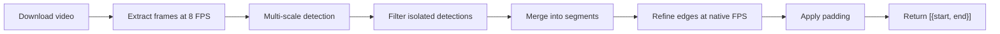

**Multi-scale detection** runs each frame through:
1. Full frame at 300×300 and 500×500 (for large frames)
2. Center crop 60% (for centered subjects like TikTok)
3. Upper portion crop (for portrait video with face at top)

**Configuration:**

| Parameter | Standard | Frame-Accurate |
|-----------|----------|----------------|
| Sample FPS | 8 | 15 |
| Merge gap | 0.5s | 0.15s |
| Min duration | 1.0s | 0.1s |
| Confidence threshold | 0.5 | 0.5 |
| Face size range | 3–90% of frame | 3–90% of frame |
| Thread workers | 6 | 8 |

### 2.4 Swap Modes

| Mode | AI Service | Max Chunk | Best For |
|------|-----------|-----------|----------|
| `fullbody` | Kling Pro Motion (fal-ai) | 25 seconds | Full character replacement, body animation |
| `face` | WaveSpeed Animate | 120 seconds | Precise face-only replacement with lip sync |

**Kling Pro Motion** (`kling.service.ts → klingProMotion()`):
- Endpoint: `fal-ai/kling-video/v2.6/pro/motion-control`
- Input: reference image URL + source video URL
- Supports `characterOrientation: "image" | "video"`
- Timeout: 30 minutes

**WaveSpeed Animate** (`wavespeed.service.ts → wanAnimate()`):
- Model: `wavespeed-ai/wan-2.2/animate`
- Modes: `animate` (move face) or `replace` (replace face in video)
- Resolution: 480p or 720p

### 2.5 Worker Processing Pipeline

**Processor:** `backend/src/worker/processors/klingFaceSwapProcessor.ts`

| Step | Progress | Operation |
|------|----------|-----------|
| 1 | 10–15% | Download reference face image and video from S3 |
| 2 | 15% | Face detection via Lambda (with padding) |
| 3 | 15% | Filter segments (max 5 segments, max 300s total) |
| 4 | 15–82% | Process segments in parallel (max 3 concurrent) |
| 4a | — | Extract frame → Generate pose reference (FAL) |
| 4b | — | Cut into chunks → Process via Kling/WaveSpeed |
| 4c | — | Merge chunks into processed segment |
| 5 | 82% | Lip sync (face mode only) |
| 6 | 82–85% | Splice with original (if splice mode) |
| 7 | 92% | Voice conversion (if voiceId provided) |
| 8 | 95–100% | Upload final video, create clip, transcribe |

Parallel processing: up to 3 segments × 3 chunks = 9 concurrent AI generation tasks.

### 2.6 Splice Mode

When `spliceMode=true`, the processor interleaves processed face-swap segments with original (unprocessed) segments from the source video:

```
Original:  [----A----][---B---][----C----][---D---]
Detected:  [         ][FACE   ][         ][FACE   ]
Processed: [----A----][SWAPPED][----C----][SWAPPED]
```

Individual segments are uploaded to S3 separately and re-encoded for codec compatibility before final merge.

### 2.7 Voice Conversion

When a `voiceId` is provided (ElevenLabs voice ID), the final video's audio is converted:

1. Extract audio from final video
2. Convert to MP3
3. Call `elevenLabsService.speechToSpeech()` for voice conversion
4. Replace audio track in final video

### 2.8 API (External Integration)

**Controller:** `backend/src/controllers/apiFaceSwap.controller.ts`

Public API with `X-API-Key` authentication:

| Endpoint | Method | Description |
|----------|--------|-------------|
| `/v1/face-swap` | POST | Create face swap job |
| `/v1/face-swap/:jobId` | GET | Get job status |

**Billing:** Per-second pricing charged upfront. Balance checked before job creation; refunded on failure.

### 2.9 Database Schema

**`comfy_jobs` table** — tracks all face swap jobs:

| Column | Type | Description |
|--------|------|-------------|
| `id` | uuid PK | Job ID |
| `team_id` | int FK | Owning team |
| `status` | enum | `pending_upload → queued → running → completed / failed` |
| `image_file` | text | S3 key of face image |
| `video_file` | text | S3 key of video/chunks |
| `original_video_s3_key` | text | S3 key of full original video |
| `progress` | int | 0–100 |
| `output_file` | text | S3 key of final output |
| `job_type` | text | `kling-face-swap` or `api-face-swap` |
| `splice_mode` | boolean | Whether to interleave with original |
| `splice_metadata` | jsonb | Metadata for splice reconstruction |

### 2.10 Key Files

| File | Purpose |
|------|---------|
| `backend/src/controllers/apiFaceSwap.controller.ts` | API controller (public + dashboard) |
| `backend/src/routes/faceSwap.routes.ts` | Face swap routes |
| `backend/src/worker/processors/klingFaceSwapProcessor.ts` | Main processing pipeline |
| `backend/src/services/face-swap/faceSwap.service.ts` | Trim & upload utilities |
| `backend/src/services/face-swap/faceDetection.service.ts` | Lambda invocation wrapper |
| `backend/src/services/face-swap/wavespeed.service.ts` | WaveSpeed face animation |
| `backend/src/services/ai-ugc/faceSwap.service.ts` | FAL.ai face swap |
| `backend/src/services/ai-ugc/kling.service.ts` | Kling Pro Motion |
| `lambda-face-detect/handler.py` | OpenCV face detection Lambda |

---

## 3. AI UGC Video Generation

### 3.1 Overview

The AI UGC system creates fully generated video ads from product images and a text direction. The pipeline involves AI agents for script writing, image generation for scene visuals, text-to-speech for voiceover, image-to-video AI for animating scenes, and automated video assembly.

**Key capabilities:**
- AI agent-driven script generation with multiple structure templates
- AI character generation (consistent across scenes)
- Per-scene image generation with product integration
- A-roll (talking head) and B-roll (product shots/cutaways) scene types
- Multi-character podcast format support
- Text-to-speech with voice cloning
- Ambient sound generation
- Silent/visual-only video support
- Ad clone: deconstruct a reference ad and recreate with new product

### 3.2 Architecture Diagram

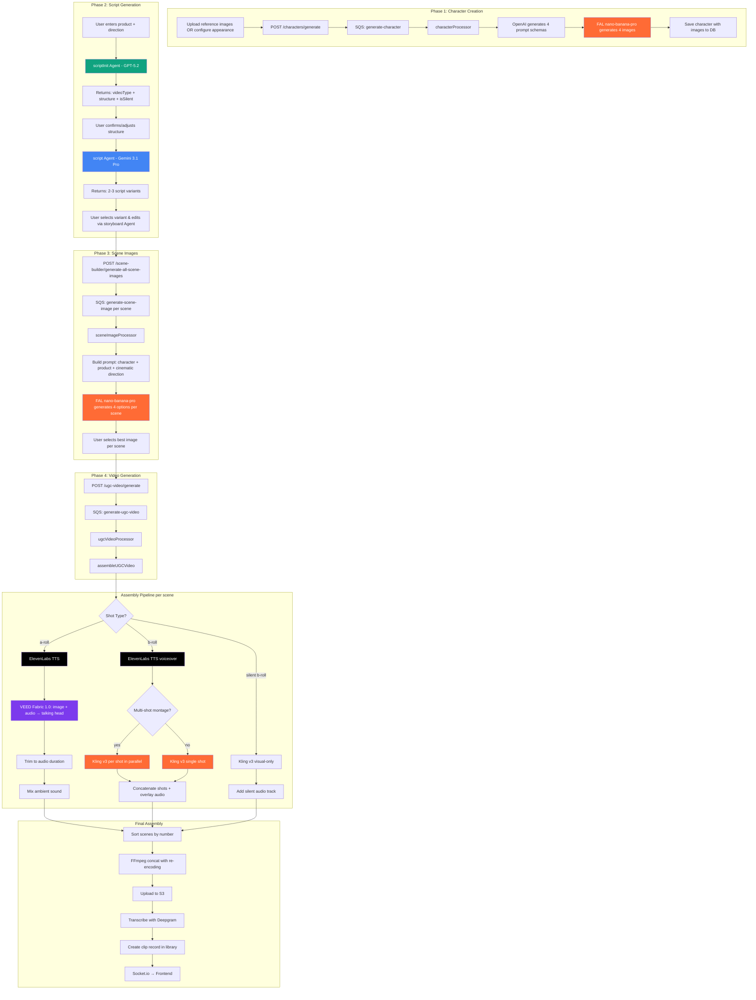

### 3.3 Character Generation

**Processor:** `backend/src/worker/processors/characterProcessor.ts`

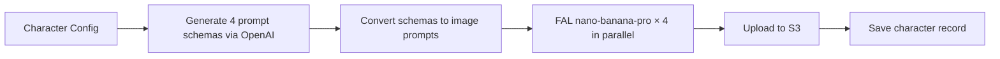

**Character config:**
- Gender, age range, vibe
- Appearance: hair color/style, skin tone, eye color, body type
- Style: outfit, setting, custom notes
- Optional reference images for face-matching

**Image generation** uses FAL's `nano-banana-pro` model at 9:16 aspect ratio. When reference images are provided, the prompt includes identity-matching instructions.

The processor generates **4 variants** in parallel. Users select their preferred variant as the primary character image.

### 3.4 Script Generation (AI Agents)

The script pipeline uses three Mastra AI agents:

#### Script Init Agent (`scriptInit-agent.ts`)

- **Model:** `openai/gpt-5.2`
- **Input:** User's loose description of desired video
- **Output:** Video type, structure, silent mode, character requirement

```typescript
{
  videoType: "ugc" | "reaction" | "montage" | "podcast" | "nocharacter_montage",
  isSilent: boolean,
  character: boolean,
  structure: [{ sceneType, slug, description }],
  message: string  // Explanation of design choices
}
```

#### Script Agent (`script-agent.ts`)

- **Model:** `google/gemini-3.1-pro-preview`
- **Input:** Structure, characters, voice style, target audience, product images
- **Output:** 2–3 full script variants with scenes, dialogue (emotion-tagged), actions, cinematic prompts

Dialogue includes ElevenLabs emotion tags on every sentence for expressive delivery (e.g., `<happy>This product changed my life!</happy>`).

#### Storyboard Agent (`storyboard-agent.ts`)

- **Model:** `openai/gpt-5.2`
- **Purpose:** Interactive script editing via chat
- **Tools available:**
  - `addSceneTool` / `removeSceneTool` — insert/delete scenes
  - `addShotsTool` / `removeShotsTool` — manage B-roll shots
  - `changeShotTypeTool` — switch between CHARACTER, PRODUCT, CHARACTER_AND_PRODUCT
  - `changeDialogueTool` — rewrite dialogue with emotion tags
  - `changeSceneDirectionTool` / `changeShotDirectionTool` — modify action/cinematic prompt
  - `regenerateThumbnailTool` — trigger image regeneration after visual changes

### 3.5 Script Structures & Scene Types

**Built-in structures** (`backend/src/config/ugcPrompts.ts`):

| Structure ID | Pattern | Description |
|-------------|---------|-------------|
| `classic` | Hook → Problem → Solution → CTA | Standard UGC format |
| `problem-agitate-solution` | Hook → Problem → Agitate → Solution → CTA | Emotional escalation |
| `social-proof` | Hook → Social Proof → Demo → Testimonial → CTA | Trust-driven |
| `storytelling` | Hook → Problem → Transformation → Testimonial → CTA | Narrative arc |
| `before-after` | Hook → Problem(B) → Solution(A) → Transformation(B) → CTA | Visual transformation |
| `unboxing` | Hook → Demo(B) → Solution(A) → CTA | ASMR-style product reveal |
| `tutorial` | Hook → Demo → Demo → Testimonial → CTA | Educational |
| `controversy` | Hook → Problem → Solution → Social Proof(B) → CTA | Bold/opinion-driven |
| `long-form` | Single continuous A-roll | Testimonials, speeches |
| `silent-before-after` | Problem(B) → Transformation(B) | No dialogue |
| `silent-showcase` | Hook(B) → Demo(B) → CTA(B) | No dialogue |
| `silent-montage` | Hook → Demo → Demo → Transformation | Aesthetic, no dialogue |
| `custom` | User-defined | Custom scene pattern |

**Scene types:** `hook`, `problem`, `agitate`, `solution`, `demo`, `social-proof`, `testimonial`, `transformation`, `cta`

**Shot types:**

| Shot Type | Description | Processing |
|-----------|-------------|------------|
| `a-roll` | Actor speaking to camera | ElevenLabs TTS → VEED Fabric talking head |
| `a-roll-multi` | Podcast / 2+ characters | Per-character TTS + multi-angle shots |
| `b-roll` | Product shots, cutaways (1–5 shots) | Kling v3 image-to-video + voiceover |
| `visual` | Silent B-roll | Kling v3 visual-only |

### 3.6 Scene Image Generation

**Processor:** `backend/src/worker/processors/sceneImageProcessor.ts`

For each scene, generates 4 image options using FAL `nano-banana-pro`:

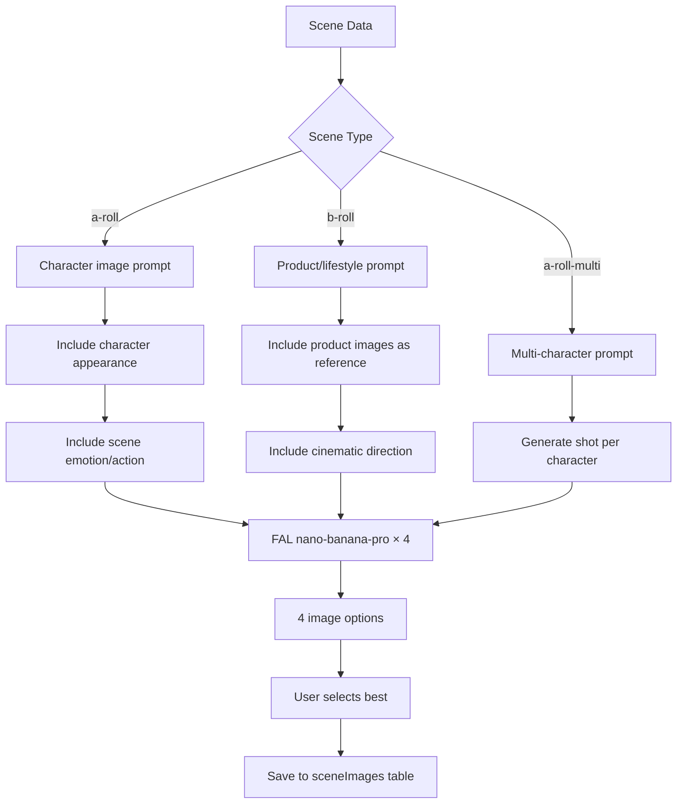

**Prompt construction** (`sceneImagePrompts.ts`):
- Character appearance details (hair, skin, outfit)
- Scene type context (hook = attention-grabbing, demo = product in action)
- Camera angle and cinematic direction
- Product images included for relevant scene types (solution, demo, CTA, testimonial)
- Previous scene anchor image for visual consistency in consecutive A-roll scenes

### 3.7 Video Assembly Pipeline

**Service:** `backend/src/services/ai-ugc/ugcVideoAssembly.service.ts`

The `assembleUGCVideo()` function orchestrates the full pipeline:

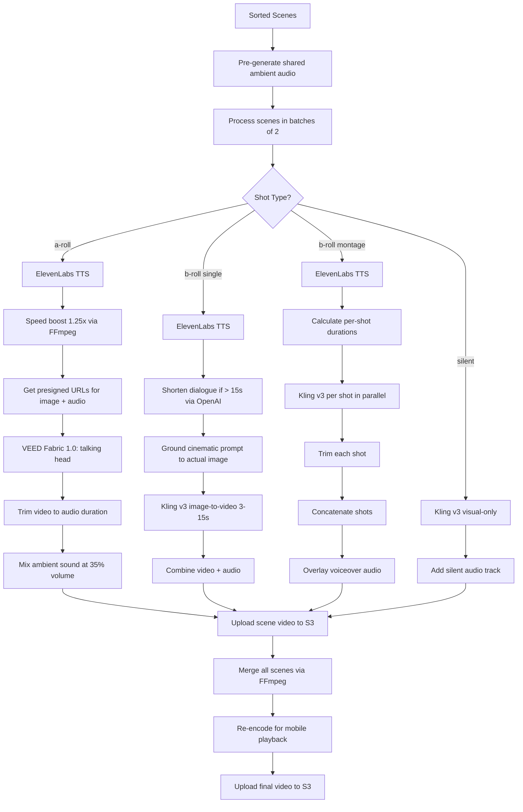

**Key constants:**

| Constant | Value | Purpose |
|----------|-------|---------|
| `MAX_KLING_VIDEO_DURATION` | 15s | Max single Kling generation |
| `MAX_AROLL_VIDEO_DURATION` | 180s | Max A-roll scene length |
| `KLING_EXTENSION_DURATION` | 5s | Extension chunk size |
| `PARALLEL_SCENES` | 2 | Scenes processed concurrently |
| `SPEECH_SPEED_BOOST` | 1.25x | Default TTS speed multiplier |

**Video extension:** When generated video is shorter than audio, the system extracts the last frame and uses it as a start image for a continuation segment via Kling v3, then merges all segments.

**A-roll processing (VEED Fabric 1.0):**
- Takes character image + pre-generated audio
- Produces lip-synced talking head video with natural head movement
- Endpoint: `veed/fabric-1.0` via FAL

**B-roll processing (Kling v3):**
- Takes scene image + cinematic prompt
- Uses `generateGroundedCinematicPrompt()` — OpenAI analyzes the actual image and grounds the motion prompt in what's visible
- Endpoint: `fal-ai/kling-video/v3/pro/image-to-video`

### 3.8 Voice Cloning

**Service:** `backend/src/services/ai-ugc/elevenlabs.service.ts`

| Operation | Method | Description |
|-----------|--------|-------------|
| Clone voice | `cloneVoice()` | Upload audio sample → ElevenLabs creates voice ID |
| Preview | `generateClonePreview()` | Generate test audio with cloned voice |
| TTS | `generateSpeech()` | Text-to-speech with emotion tags |
| STS | `speechToSpeech()` | Convert speech to cloned voice |
| Delete | `deleteClonedVoice()` | Remove from ElevenLabs + DB |

**TTS configuration:**
- Model: `eleven_v3`
- Output: `mp3_44100_128`
- Voice settings: stability=0.5, similarity_boost=0.8, style=0.45, speaker_boost=true

Cloned voices are stored in the `cloned_voices` table and available for selection in the UGC video creation flow.

### 3.9 Ad Clone Flow

Ad Clone deconstructs a reference video ad and recreates it with a new product:

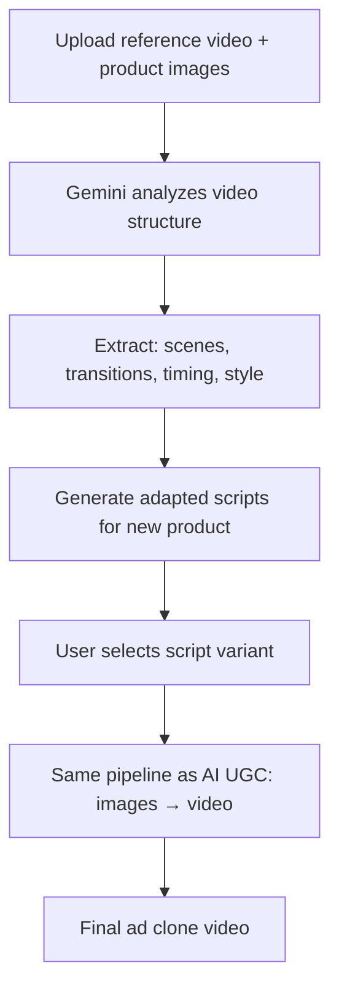

**Database:** `ad_clone_projects` table tracks the full lifecycle:
`uploading → analyzing → analysis_complete → generating_script → script_generated → generating_video → completed`

### 3.10 Database Schema

**`characters`** — AI-generated character personas:

| Column | Type | Description |
|--------|------|-------------|
| `id` | serial PK | Character ID |
| `character_images` | jsonb | Array of S3 keys (4 variants) |
| `primary_image_index` | int | Selected variant index |
| `appearance_config` | jsonb | Hair, skin, eyes, body type |
| `style_config` | jsonb | Outfit, setting |
| `reference_images` | jsonb | User-provided face references |

**`ugc_scripts`** — generated scripts:

| Column | Type | Description |
|--------|------|-------------|
| `id` | uuid PK | Script ID |
| `scripts_data` | jsonb | Array of script variants (2–3) |
| `selected_variant_index` | int | User's chosen variant |
| `structure_id` | varchar | Template ID (classic, PAS, etc.) |
| `is_silent` | boolean | No-dialogue mode |
| `has_character` | boolean | Whether script uses a character |
| `video_type` | varchar | ugc, reaction, montage, podcast |

**`scene_image_generation_jobs`** — per-scene image generation tracking.

**`scene_images`** — selected images per scene (with optional `end_image_key` for video interpolation).

**`ugc_video_generation_jobs`** — video generation job tracking:

| Column | Type | Description |
|--------|------|-------------|
| `id` | uuid PK | Job ID |
| `script_id` | uuid FK | Source script |
| `voice_id` | varchar | ElevenLabs voice ID |
| `scene_videos` | jsonb | `[{sceneId, sceneNumber, audioKey, videoKey}]` |
| `final_video_key` | text | S3 key of final assembled video |
| `total_duration_seconds` | real | Final video length |

**`cloned_voices`** — team's custom voice clones.

### 3.11 Key Files

| File | Purpose |
|------|---------|
| `backend/src/routes/ugcScript.routes.ts` | Script generation routes |
| `backend/src/routes/ugcVideo.routes.ts` | Video generation routes |
| `backend/src/routes/sceneBuilder.routes.ts` | Scene image routes |
| `backend/src/controllers/ugcScript.controller.ts` | Script controller |
| `backend/src/controllers/ugcVideo.controller.ts` | Video controller |
| `backend/src/controllers/sceneBuilder.controller.ts` | Scene builder controller |
| `backend/src/services/ai-ugc/ugcScript.service.ts` | Script generation logic |
| `backend/src/services/ai-ugc/ugcVideoAssembly.service.ts` | Video assembly pipeline |
| `backend/src/services/ai-ugc/elevenlabs.service.ts` | TTS + voice cloning |
| `backend/src/services/ai-ugc/kling.service.ts` | Kling image-to-video |
| `backend/src/services/ai-ugc/veedFabric.service.ts` | VEED talking head |
| `backend/src/services/ai-ugc/falImage.service.ts` | FAL image generation |
| `backend/src/worker/processors/characterProcessor.ts` | Character image generation |
| `backend/src/worker/processors/sceneImageProcessor.ts` | Scene image generation |
| `backend/src/worker/processors/ugcVideoProcessor.ts` | Video generation orchestrator |
| `backend/src/config/ugcPrompts.ts` | Script structures + prompts |
| `agent-service/src/mastra/agents/script-agent.ts` | Script generation agent |
| `agent-service/src/mastra/agents/scriptInit-agent.ts` | Script init agent |
| `agent-service/src/mastra/agents/storyboard-agent.ts` | Script editing agent |

---

## 4. Shared Infrastructure

### 4.1 SQS Job Queue

**Service:** `backend/src/services/sqs.service.ts`

All async processing flows through a single SQS queue with job-type routing:

| Job Type | Processor | Feature |
|----------|-----------|---------|
| `clip-video` | `clipProcessor` | AI Clipping |
| `batch-clip-video` | `batchClipProcessor` | Multi-source clipping |
| `update-captions` | `captionsProcessor` | Caption editing |
| `text-overlay` | `textOverlayProcessor` | Heading editing |
| `update-overlays` | `overlaysProcessor` | Combined edit |
| `video-edit` | `videoEditProcessor` | Full video editing |
| `generate-character` | `characterProcessor` | AI UGC |
| `generate-scene-image` | `sceneImageProcessor` | AI UGC |
| `generate-ugc-video` | `ugcVideoProcessor` | AI UGC |
| `kling-face-swap` | `klingFaceSwapProcessor` | Face Swap |
| `ad-clone-analyze` | `adCloneProcessor` | Ad Clone |
| `ad-clone-generate-script` | `adCloneProcessor` | Ad Clone |
| `ad-posting` | `adPostingProcessor` | Mass Posting |

### 4.2 Worker Architecture

**Entry point:** `backend/src/worker/index.ts`

| Setting | Value | Purpose |
|---------|-------|---------|
| Max concurrent jobs | 5 | Total across all types |
| Max concurrent clip jobs | 3 | Gemini file storage quota |
| Visibility timeout | 900s (15 min) | SQS message lock |
| Heartbeat interval | 300s (5 min) | Extends visibility during processing |
| Graceful shutdown | 110s | ECS safe shutdown window |

**ECS Fargate:** Runs as a separate service (8 vCPU, 16 GB RAM) with task protection enabled to prevent scale-in during active processing.

### 4.3 Real-Time Updates (Socket.io)

All features emit progress updates via Socket.io for real-time frontend updates:

| Event | Feature | Data |
|-------|---------|------|
| `clips-refresh` | AI Clipping | Clip ID, status |
| `face-swap-progress` | Face Swap | Job ID, progress %, message |
| `character-generated` | AI UGC | Job ID, character images |
| `scene-images-ready` | AI UGC | Job ID, generated images |
| `ugc-video-progress` | AI UGC | Job ID, progress %, current scene |
| `ad-clone-progress` | Ad Clone | Project ID, status, progress |

### 4.4 External AI Services Summary

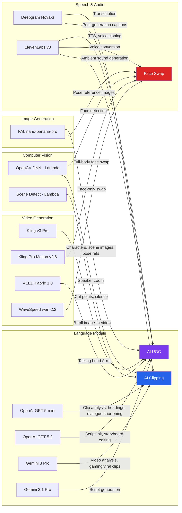

| Service | Used By | Purpose |
|---------|---------|---------|
| **OpenAI GPT-5-mini** | Clipping, UGC | Clip analysis, headings, dialogue editing |
| **OpenAI GPT-5.2** | UGC | Script init agent, storyboard agent |
| **Gemini 3 Pro** | Clipping | Video-aware clip analysis (gaming/viral) |
| **Gemini 3.1 Pro** | UGC | Script generation agent |
| **Deepgram Nova-3** | Clipping, UGC | Speech-to-text transcription |
| **ElevenLabs v3** | UGC, Face Swap | TTS, voice cloning, STS, ambient sounds |
| **FAL nano-banana-pro** | UGC, Face Swap | Character + scene image generation |
| **Kling v3 Pro** | UGC | Image-to-video (B-roll) |
| **Kling Pro Motion v2.6** | Face Swap | Full-body character animation |
| **VEED Fabric 1.0** | UGC | Talking head video (A-roll) |
| **WaveSpeed wan-2.2** | Face Swap | Face-only replacement |
| **OpenCV DNN** | Clipping, Face Swap | Face detection (Lambda) |
| **FFmpeg** | All | Video processing, encoding, merging |
