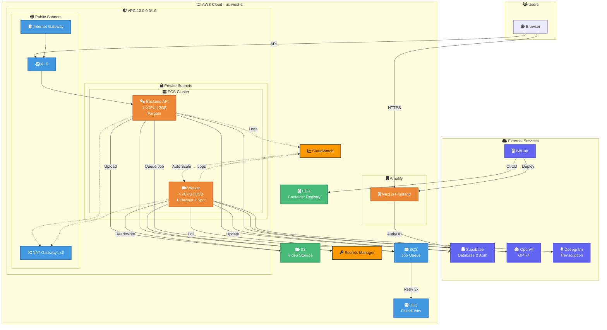

# Clipster Infrastructure Architecture

## Overview

Clipster is a video clipping platform with a Next.js frontend hosted on AWS Amplify and a Node.js/Express backend running on ECS Fargate with auto-scaling video processing workers.

## Architecture Diagram



## Component Details

### Frontend (AWS Amplify)
| Property | Value |
|----------|-------|
| Framework | Next.js 14 |
| Hosting | AWS Amplify |
| Deploy | Auto from GitHub `main` branch |
| Domain | Amplify default (custom domain ready) |

### Backend API (ECS Fargate)
| Property | Value |
|----------|-------|
| Runtime | Node.js + Express |
| CPU/Memory | 1 vCPU / 2 GB |
| Auto-scaling | 1-10 tasks |
| Load Balancer | ALB (HTTP :80) |

### Video Worker (ECS Fargate + Spot)
| Property | Value |
|----------|-------|
| Runtime | Node.js + FFmpeg |
| CPU/Memory | 4 vCPU / 8 GB |
| Base | 1 Fargate (always-on) |
| Scaling | 1-250 Fargate Spot |
| Scale Up | 30 sec cooldown |
| Scale Down | 3 min after queue empty |
| Trigger | 1 worker per SQS message |

### Storage (S3)
| Path | Purpose | Lifecycle |
|------|---------|-----------|
| `raw-videos/` | Uploaded videos | Delete after 60 days |
| `generated-clips/` | Processed clips | Standard → IA (30d) → Glacier (90d) |

### Queue (SQS)
| Property | Value |
|----------|-------|
| Visibility Timeout | 15 minutes |
| Message Retention | 1 day |
| Dead Letter Queue | After 3 failures |
| DLQ Retention | 14 days |

### Secrets Manager
| Secret | Purpose |
|--------|---------|
| `openai-api-key` | GPT-4 API |
| `deepgram-api-key` | Transcription API |
| `database-url` | Supabase Postgres |
| `supabase-anon-key` | Supabase Auth |
| `internal-api-key` | Worker → API auth |

### External Services
| Service | Purpose |
|---------|---------|
| **Supabase** | PostgreSQL database + Auth |
| **OpenAI** | Video analysis, clip selection |
| **Deepgram** | Audio transcription |
| **GitHub** | Source code + CI/CD triggers |

## Network Architecture

```
VPC: 10.0.0.0/16
├── Public Subnets (2 AZs)
│   ├── 10.0.1.0/24 (us-west-2a)
│   ├── 10.0.2.0/24 (us-west-2b)
│   ├── Internet Gateway
│   ├── NAT Gateway x2
│   └── Application Load Balancer
│
└── Private Subnets (2 AZs)
    ├── 10.0.10.0/24 (us-west-2a)
    ├── 10.0.11.0/24 (us-west-2b)
    └── ECS Tasks (Backend + Worker)
```

## Data Flow

### Video Upload & Processing
```
1. User uploads video → Frontend
2. Frontend → Backend API (via ALB)
3. Backend uploads to S3 (raw-videos/)
4. Backend sends job to SQS
5. Worker polls SQS, picks up job
6. Worker downloads from S3
7. Worker processes with FFmpeg
8. Worker calls Deepgram (transcription)
9. Worker calls OpenAI (clip selection)
10. Worker uploads clips to S3 (generated-clips/)
11. Worker updates Supabase database
12. Frontend polls for status, shows results
```

## Cost Estimate (Monthly)

| Component | Cost |
|-----------|------|
| 1 Always-on Worker (4 vCPU/8GB) | ~$140 |
| Backend API (1 vCPU/2GB) | ~$35 |
| ALB | ~$20 |
| NAT Gateways x2 | ~$65 |
| S3 Storage (100GB) | ~$3 |
| SQS | ~$1 |
| Secrets Manager | ~$2 |
| CloudWatch | ~$5 |
| **Baseline Total** | **~$270/mo** |
| Extra Spot workers | ~$0.06/hr each |
