# Virality Tracker & Mass Posting — Architecture Guide

## System Overview

The Virality Tracker and Mass Posting systems are two interconnected features that together form Clipper's social media intelligence and distribution pipeline. Mass Posting distributes video content across social accounts, and the Virality Tracker monitors performance metrics on those posts (and competitor accounts).

```mermaid
graph LR
    subgraph Mass Posting
        A[User uploads clip] --> B[Credit deduction]
        B --> C[SQS Job queued]
        C --> D[Worker: FFmpeg scramble]
        D --> E[Upload to Google Drive]
        E --> F[Botfarm posts to social]
        F --> G[Webhook: markAsPosted]
    end

    subgraph Bridge
        G --> H[Resolve account from URL]
        H --> I[Create userAccount]
        I --> J[Create userPost]
        J --> K[Initial Apify scrape]
    end

    subgraph Virality Tracker
        K --> L[Lambda sync every 12h]
        L --> M[Apify scrape metrics]
        M --> N[Update metrics_history]
        N --> O[Detect viral posts]
        O --> P[Send alert emails + PDF]
    end
```

---

## Part 1: Mass Posting

### What It Does

Mass Posting lets users publish a single video clip to multiple social media accounts simultaneously. The system handles video uniquification (to avoid platform duplicate detection), Google Drive delivery, and tracks every post from creation to publication.

### Request Flow

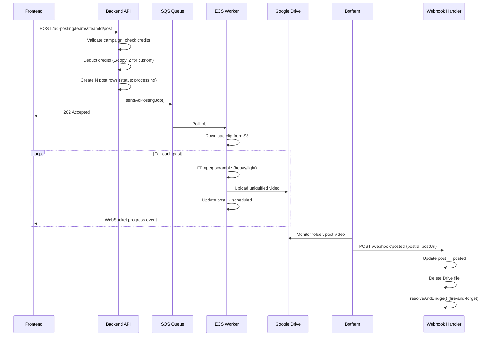

### Credit System

| Action | Cost |
|--------|------|
| Post library clip (per copy) | 1 credit |
| Post custom upload (per copy) | 2 credits |
| Campaign posting | 0 credits (wallet-funded) |

Credits are deducted upfront before the SQS job is queued. If the team has insufficient credits, the request is rejected with 402.

### Video Uniquification

The worker applies two scrambling levels to avoid platform duplicate detection:

- **Heavy (default)**: Full FFmpeg re-encode with codec perturbations, audio resampling, metadata injection, optional adversarial perturbation, SSCD similarity check
- **Light**: Stream-copy with jumbled metadata only (no re-encode)

### Drive Folder Structure

```
{campaignFolder}/
  {MM-DD-YYYY}/
    TikTok/
      {postId}.mp4
    Instagram/
      {postId}.mp4
    Facebook/
      {postId}.mp4
```

### Post Status Lifecycle

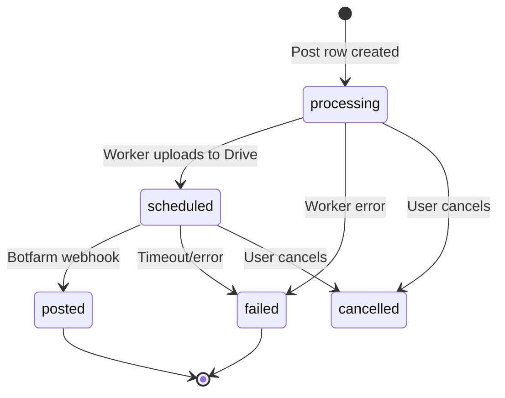

### Key Files

| File | Purpose |
|------|---------|
| `backend/src/controllers/adPosting.controller.ts` | REST endpoints for posting, custom uploads, webhook |
| `backend/src/services/adPosting.service.ts` | Core logic: validation, credit deduction, bridge to tracking |
| `backend/src/routes/adPosting.routes.ts` | Route definitions with OpenAPI docs |
| `backend/src/worker/processors/adPostingProcessor.ts` | SQS worker: FFmpeg, Drive upload, progress events |

### API Endpoints

| Method | Path | Auth | Description |
|--------|------|------|-------------|
| POST | `/ad-posting/teams/:teamId/post` | User | Start posting clip to platforms |
| POST | `/ad-posting/teams/:teamId/custom-video` | User | Get presigned S3 URL for custom upload |
| POST | `/ad-posting/teams/:teamId/custom-video/:clipId/complete` | User | Finalize custom upload |
| GET | `/ad-posting/teams/:teamId/posts` | User | Paginated posts (filter: tab, platform, date, search) |
| GET | `/ad-posting/teams/:teamId/clips/:clipId/posts` | User | Posts for specific clip |
| GET | `/ad-posting/teams/:teamId/accounts` | User | Account posting statistics |
| POST | `/ad-posting/webhook/posted` | Secret | Botfarm marks post as published |

---

## Part 2: Campaign System

Campaigns are admin-approved posting programs with their own billing (CPM-based) and contract workflows. They wrap mass posting with additional controls.

### Campaign Lifecycle

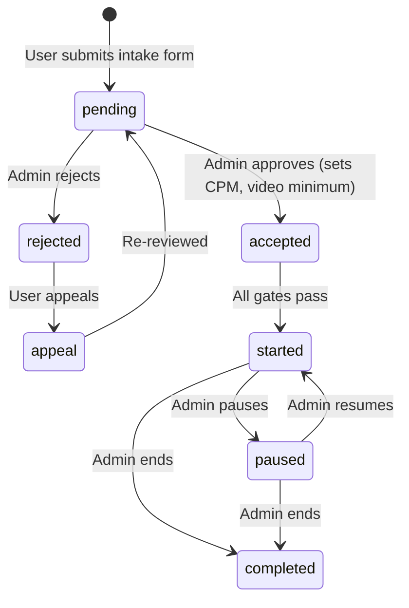

### Campaign Gates

Before a campaign can start, three gates must all be `true`:

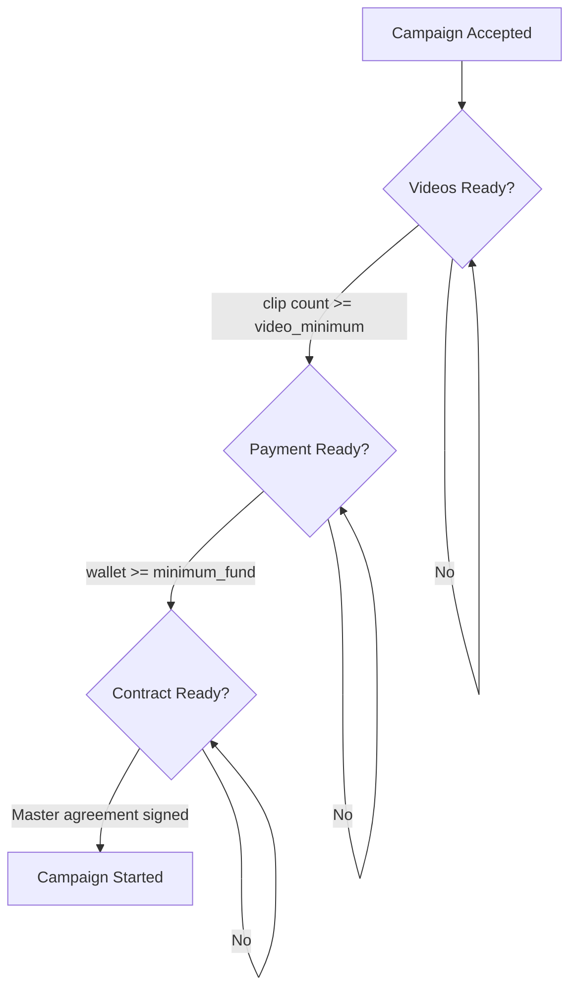

### Key Files

| File | Purpose |
|------|---------|
| `backend/src/services/massPosting/campaign.service.ts` | Campaign CRUD, approval, gates |
| `backend/src/services/massPosting/campaignBilling.service.ts` | Wallet top-ups, credit conversion |
| `backend/src/services/massPosting/campaignContract.service.ts` | Master agreement PDF generation + signing |
| `backend/src/services/massPosting/campaignVideo.service.ts` | Campaign video library management |
| `backend/src/services/massPosting/cpmBilling.service.ts` | CPM billing breakdown |
| `backend/src/services/massPosting/intake.service.ts` | Application + appeal flow |

---

## Part 3: Virality Tracker

### What It Does

The Virality Tracker monitors social media accounts and their posts, tracking metrics over time (views, likes, comments, followers). It detects viral content and sends alert emails. It tracks two categories of accounts:

1. **Competitor accounts** (`viralityAccounts`) — external accounts added for competitive intelligence
2. **User performance accounts** (`userAccounts`) — the team's own accounts, auto-created when mass posts are published

### Sync Architecture

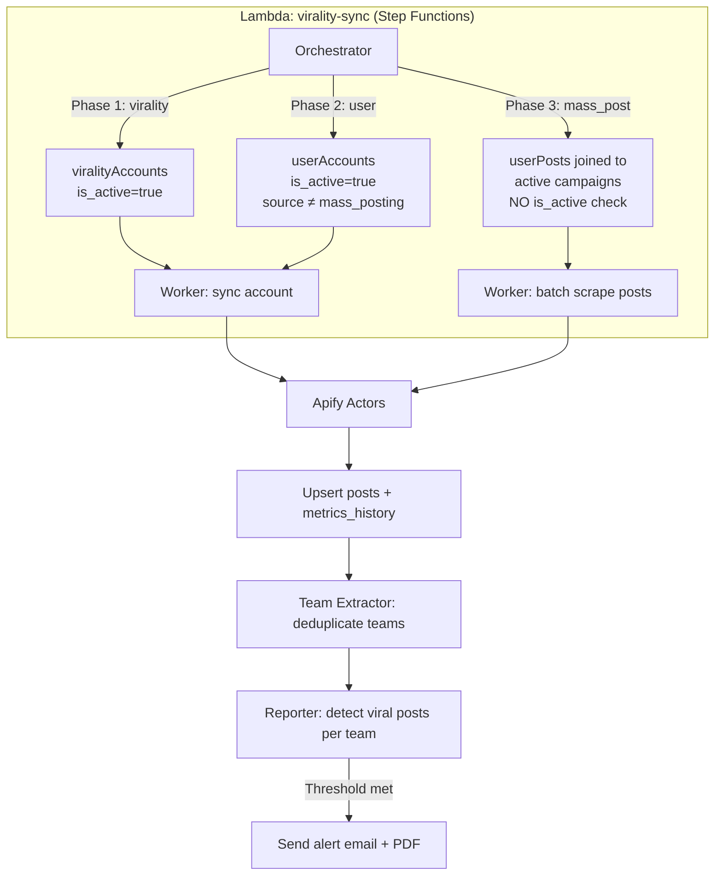

### Three Sync Phases

The lambda orchestrator runs cursor-based pagination through three phases:

| Phase | Source Table | Filter | is_active Check | Purpose |
|-------|-------------|--------|-----------------|---------|
| **virality** | `viralityAccounts` | `is_active = true` | Yes | Competitor tracking |
| **user** | `userAccounts` | `is_active = true`, `source ≠ 'mass_posting'` | Yes | User's manually-added accounts |
| **mass_post** | `userPosts` → `posts` → `campaigns` | `campaign.status = 'started'`, `syncs_remaining > 0` | **No** | Active campaign posts (always syncs) |

This phase design is critical for the downgrade behavior: setting `is_active = false` on all accounts pauses phases 1 & 2 but phase 3 (campaign syncing) continues unaffected.

### Credit System for Syncing

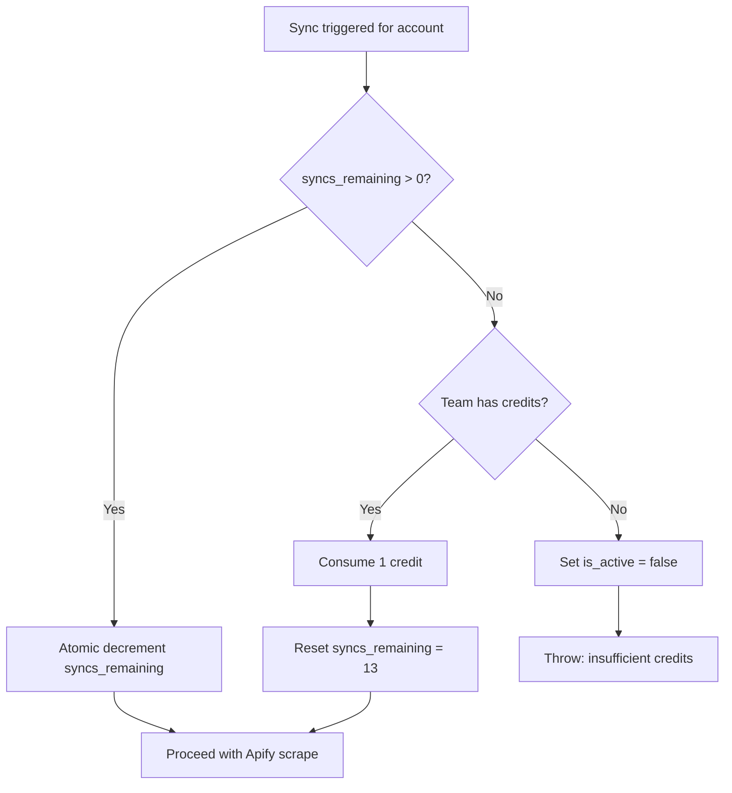

- Each account starts with `syncs_remaining = 14` (= 2 syncs/day × 7 days)
- Every 14 syncs costs 1 credit
- If no credits remain, the account is auto-deactivated

### Metrics Protection

The system implements two protection mechanisms against flaky scraper data:

**Likes/Comments** — Zero-suppression: If the scraper returns 0 but the previous measurement had data, the previous value is preserved (scrapers sometimes return 0 on rate-limited requests).

**Views** — Strict monotonicity: Views can never decrease. The system always stores `Math.max(incoming, previous)`.

```
metrics_history: [
  { recorded_at: "2026-04-01T00:00Z", likes: 150, comments: 12, views: 5000 },
  { recorded_at: "2026-04-01T12:00Z", likes: 210, comments: 18, views: 8500 },
  { recorded_at: "2026-04-02T00:00Z", likes: 280, comments: 25, views: 12000 },
  ...
]
```

- Max 62 entries per post (31 days × 2 syncs/day)
- Max 180 entries for follower history (~6 months)

### Viral Alert Detection

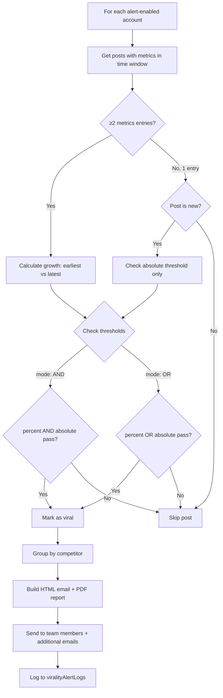

**Default thresholds:** 200% growth OR absolute threshold (configurable per team). Detection window: 12/24/48 hours. Alert debounce: 12 hours between sends.

### Competitor Grouping

Accounts are organized into competitor groups for analysis:

```
Team
├── My Performance (virtual, id = -1)
│   ├── @our_instagram (userAccount)
│   └── @our_tiktok (userAccount)
├── Competitor A (viralityCompetitor)
│   ├── @competitor_a_ig (viralityAccount)
│   └── @competitor_a_tt (viralityAccount)
└── Competitor B (viralityCompetitor)
    └── @competitor_b_ig (viralityAccount)
```

### Key Files

| File | Purpose |
|------|---------|
| `backend/src/services/virality/accountTracking.service.ts` | Base class: sync logic, metrics upsert, credit gating |
| `backend/src/services/virality/virality.service.ts` | Extends base: competitor CRUD, alert settings, pause/unpause |
| `backend/src/services/virality/userPerformance.service.ts` | Instance of base class using `userAccounts`/`userPosts` tables |
| `backend/src/services/virality/apify.service.ts` | Platform scraping via Apify actors |
| `backend/src/controllers/virality.controller.ts` | REST endpoints for virality tracker |
| `backend/src/routes/virality.routes.ts` | Route definitions with OpenAPI docs |
| `lambda-virality-sync/src/handler.ts` | Step Functions orchestrator + workers |
| `lambda-virality-sync/src/viralAlerts.ts` | Viral detection algorithm + email/PDF generation |
| `backend/src/config/virality.ts` | Sync constants (intervals, limits, actor IDs) |

### API Endpoints

| Method | Path | Plan Check | Description |
|--------|------|------------|-------------|
| GET | `/virality/:teamId/accounts` | Studio+ | List tracked accounts |
| POST | `/virality/:teamId/accounts` | Studio+ | Add account (costs 1 credit) |
| GET | `/virality/:teamId/accounts/:id` | None | Get account details |
| DELETE | `/virality/:teamId/accounts/:id` | None | Delete account |
| PATCH | `/virality/:teamId/accounts/:id/status` | None | Toggle is_active |
| POST | `/virality/:teamId/accounts/:id/sync` | Studio+ | Manual sync (202 async) |
| POST | `/virality/:teamId/accounts/unpause-all` | Studio+ | Bulk reactivate all accounts |
| GET | `/virality/:teamId/accounts/:id/posts` | None | Posts for account |
| DELETE | `/virality/:teamId/posts/:id` | Studio+ | Delete tracked post |
| GET | `/virality/:teamId/dashboard` | Studio+ | Dashboard statistics |
| GET/POST | `/virality/:teamId/competitors` | Studio+ | Competitor CRUD |
| GET/PATCH/DELETE | `/virality/:teamId/competitors/:id` | Varies | Individual competitor |
| PATCH | `/virality/:teamId/accounts/:id/alerts` | None | Toggle alert_enabled |
| GET/PUT | `/virality/:teamId/settings` | Studio+ | Alert config |
| GET | `/virality/:teamId/alert-logs` | Studio+ | Alert history |

---

## Part 4: The Bridge — How Mass Posting Connects to Virality

The two systems connect when a mass post is successfully published. This is the critical integration point.

### Bridge Flow

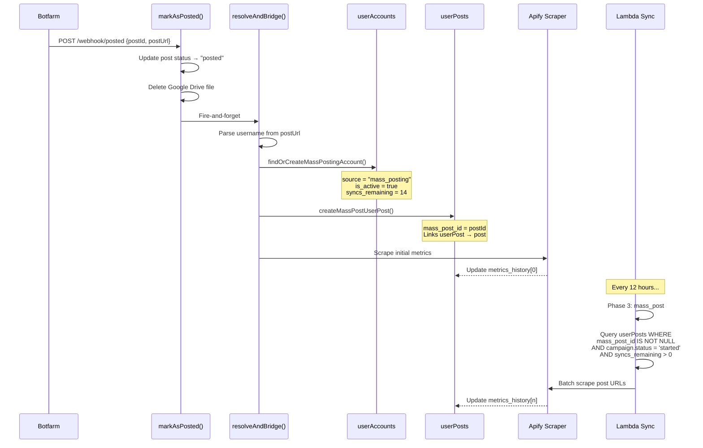

### Data Model Connection

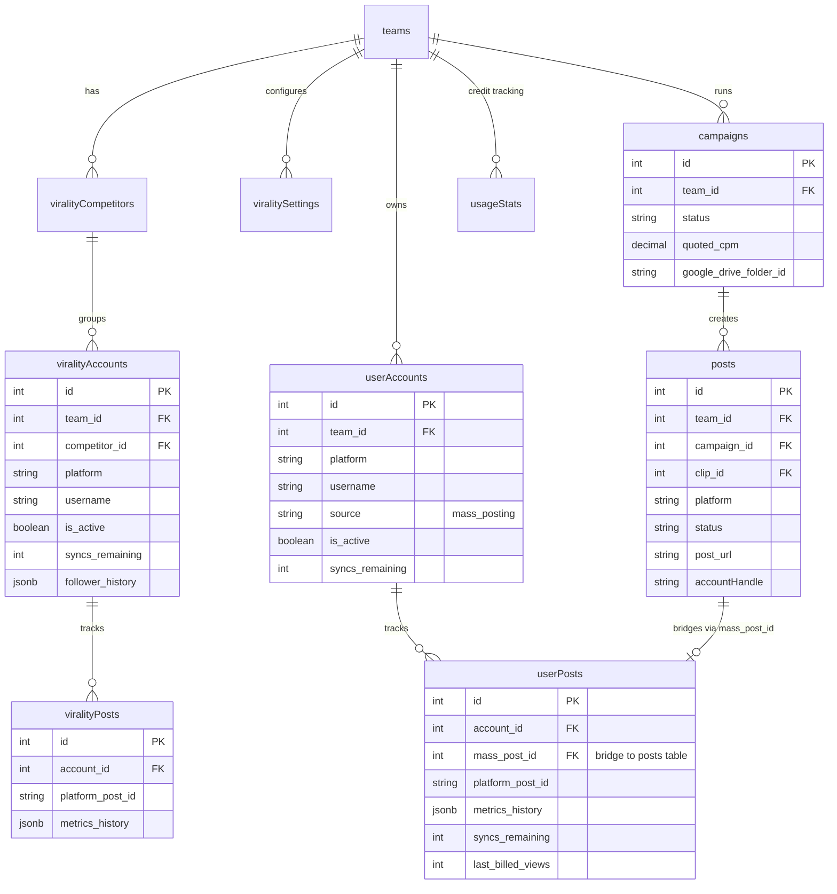

### Key Distinction: source = "mass_posting"

The `source` field on `userAccounts` is how the lambda distinguishes between manually-added user accounts and auto-created mass posting accounts:

- **Phase 2 (user)**: `WHERE source IS NULL OR source != 'mass_posting'` — syncs manual accounts
- **Phase 3 (mass_post)**: Joins through `userPosts.mass_post_id → posts → campaigns` — syncs campaign-linked posts directly

This means mass posting accounts are never synced in phase 2. They're only synced in phase 3 when they belong to active campaigns.

---

## Part 5: Downgrade Behavior

When a team's subscription is canceled (downgraded to free):

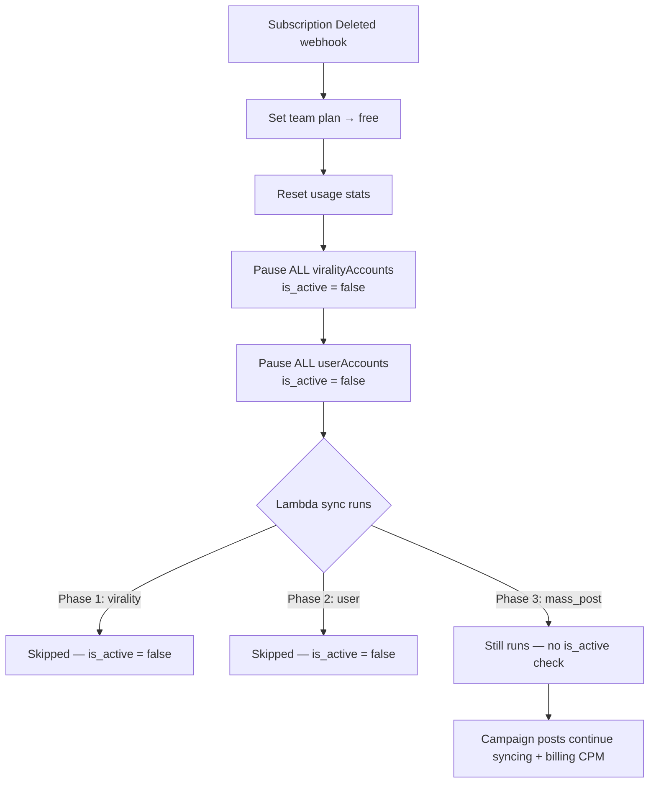

**What's preserved:**
- Campaign-linked post syncing (phase 3 ignores `is_active`)
- All existing data (accounts, posts, metrics) — read-only access
- Mass posting functionality (no plan gate)

**What's blocked:**
- Virality dashboard / analytics (plan check: Studio+)
- Adding new accounts or competitors
- Manual sync triggers
- Alert settings management

**Reactivation:** When the team upgrades again, the UI shows a banner with "Reactivate All" button that calls `POST /virality/:teamId/accounts/unpause-all`.

---

## Part 6: Apify Actors

| Platform | Actor | Purpose |
|----------|-------|---------|
| Instagram | `apify/instagram-scraper` | Scrape profile posts |
| Instagram | `apify/instagram-profile-scraper` | Scrape profile metadata |
| TikTok | `clockworks/tiktok-scraper` | Scrape profile posts |
| X/Twitter | `apidojo/twitter-scraper-lite` | Scrape tweets |
| X/Twitter | `scrape.badger/twitter-tweets-scraper` | Get view counts (separate actor) |

**Actor timeout:** 15 minutes per call. **Scrape window:** Last 31 days of posts.

X/Twitter requires two actor calls: one for tweet content and one for view counts (which are provided by a different actor).

---

## Part 7: Configuration Constants

| Constant | Value | Location |
|----------|-------|----------|
| `SYNC_INTERVAL_HOURS` | 12 | `backend/src/config/virality.ts` |
| `SYNCS_PER_DAY` | 2 | `backend/src/config/virality.ts` |
| `SYNCS_PER_WEEK` | 14 | Derived (2 × 7) |
| `SCRAPE_WINDOW_DAYS` | 31 | `backend/src/config/virality.ts` |
| `MAX_METRICS_HISTORY` | 62 | Derived (31 × 2) |
| `MAX_FOLLOWER_HISTORY` | 180 | `backend/src/config/virality.ts` |
| `STALE_SYNC_MINUTES` | 15 | `backend/src/config/virality.ts` |
| `ACTOR_TIMEOUT_SECS` | 900 | `backend/src/services/virality/apify.service.ts` |
| `PAGE_SIZE` | 100 | `lambda-virality-sync/src/handler.ts` |
| `DEBOUNCE_HOURS` | 12 | `lambda-virality-sync/src/viralAlerts.ts` |

---

## Part 8: Frontend Components

### Virality Tracker UI

| Component | File | Purpose |
|-----------|------|---------|
| Main page | `frontend/app/dashboard/virality/page.tsx` | Dashboard with competitor cards, tables, charts |
| Competitor detail | `frontend/app/dashboard/virality/[competitorId]/page.tsx` | Deep-dive into a competitor's accounts + posts |
| My Performance | `frontend/app/dashboard/virality/my-performance/page.tsx` | User's own account metrics |
| AccountsTable | `frontend/components/virality/AccountsTable.tsx` | Sortable table with status/alert toggles |
| CompetitorCard | `frontend/components/virality/CompetitorCard.tsx` | Summary card with KPIs and change indicators |
| ViralSettingsModal | `frontend/components/virality/ViralSettingsModal.tsx` | Alert threshold configuration |
| AddAccountModal | `frontend/components/virality/AddAccountModal.tsx` | Add profile/hashtag/keyword to track |
| HeadToHeadTable | `frontend/components/virality/HeadToHeadTable.tsx` | Side-by-side competitor comparison |
| ActivityFeed | `frontend/components/virality/ActivityFeed.tsx` | Recent post activity stream |
| ViralityUpgradeWall | `frontend/components/virality/ViralityUpgradeWall.tsx` | Shown when plan < Studio |

### Mass Posting UI

| Component | File | Purpose |
|-----------|------|---------|
| Main page | `frontend/app/dashboard/mass-posting/page.tsx` | Post creation, queue, published tabs |
| API client | `frontend/api/adPosting/` | API methods for posting + stats |

### Shared API Clients

| Client | File | Key Methods |
|--------|------|-------------|
| Virality | `frontend/api/virality/index.ts` | `getAccounts`, `addAccount`, `syncAccount`, `unpauseAllAccounts`, `getDashboardStats` |
| User Performance | `frontend/api/userPerformance/index.ts` | Same interface as virality but for user's own accounts |
| Ad Posting | `frontend/api/adPosting/index.ts` | `postClip`, `getPostsForTeam`, `getAccountStats` |

---

## Quick Reference: Complete File Index

### Backend Services
- `backend/src/services/virality/accountTracking.service.ts` — Base sync + metrics logic (990 lines)
- `backend/src/services/virality/virality.service.ts` — Competitor CRUD, alerts, pause/unpause
- `backend/src/services/virality/userPerformance.service.ts` — User account tracking (thin wrapper)
- `backend/src/services/virality/apify.service.ts` — Platform scraping integration
- `backend/src/services/adPosting.service.ts` — Mass posting core logic
- `backend/src/services/massPosting/campaign.service.ts` — Campaign lifecycle
- `backend/src/services/massPosting/campaignBilling.service.ts` — Wallet + credit billing
- `backend/src/services/massPosting/campaignContract.service.ts` — Master agreement PDFs
- `backend/src/services/massPosting/campaignVideo.service.ts` — Campaign video management
- `backend/src/services/massPosting/cpmBilling.service.ts` — CPM billing breakdown
- `backend/src/services/massPosting/intake.service.ts` — Application + appeal flow

### Controllers & Routes
- `backend/src/controllers/virality.controller.ts` — Virality REST handlers
- `backend/src/controllers/adPosting.controller.ts` — Mass posting REST handlers
- `backend/src/routes/virality.routes.ts` — Virality route definitions
- `backend/src/routes/adPosting.routes.ts` — Mass posting route definitions

### Worker
- `backend/src/worker/processors/adPostingProcessor.ts` — SQS job processor (FFmpeg + Drive)

### Lambda
- `lambda-virality-sync/src/handler.ts` — Step Functions orchestrator + workers
- `lambda-virality-sync/src/viralAlerts.ts` — Viral detection + email/PDF alerts

### Database
- `packages/shared-db/src/schema.ts` — All table definitions

### Config
- `backend/src/config/virality.ts` — Sync intervals, actor IDs, limits
- `backend/src/utils/parseUsername.ts` — Platform URL → username parsing
- `backend/src/utils/postIdentifier.ts` — Post URL → canonical ID extraction
